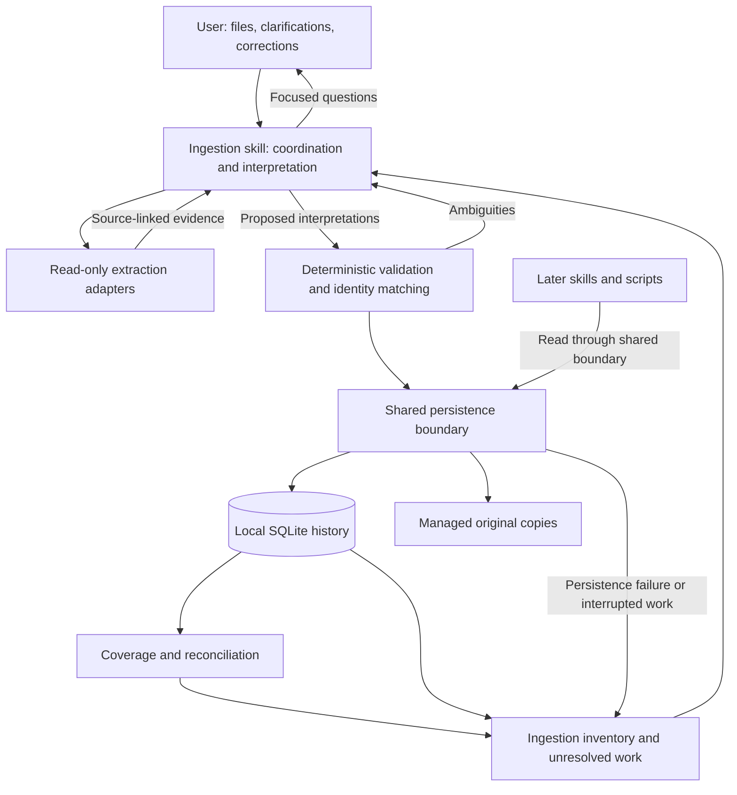

# BL-001 ingestion architecture — revision 1

Assignment ARCH-BANK-001 r1; BL-001 scope8; approved backlog/queue8. Input: requirements revision3, APR-ING-REQ-003. Status: **Proposed; architecture approval required**.

## Outcome and fixed boundaries

One distributed ingestion skill coordinates evidence extraction, clarification and deterministic Python helpers. One user-selected SQLite dataset and associated retained originals provide reusable history.

SQLite, retained originals, generic text PDF/CSV/XLSX support and immediate availability despite gaps are approved constraints. This proposal does not implement Banker, tagging, transfers, analysis, forecasting, OCR, embeddings or a service. Account/card identity here supports later consolidation without performing household-spending classification.

Actual repository Python minimum is **>=3.13**, despite the stale AGENTS summary. Existing document skills provide extraction guidance; their proprietary material is reused in place, not copied into a new skill.

## Components and dependency direction

This depicts proposed responsibilities and data flow, not implemented code or module imports. Arrows are not permission to bypass the shared persistence boundary; coverage/reconciliation reads history through that boundary.

The skill explains layouts and asks questions. Extraction produces document evidence. Deterministic helpers validate proposed interpretations, protect persistence, perform identity matching and calculate coverage/reconciliation. Persistence does not depend on conversation history or downstream report generation. Future mutation capabilities must use the shared persistence boundary; future reporting may use a stable read boundary without acquiring ingestion responsibilities.

## Material decisions and alternatives

### ARCH-D01 — Separate extraction evidence from banking interpretation

**Recommended:** reuse read-only document extraction, preserve page/row/sheet evidence, and let the agent propose banking interpretations subject to deterministic validation.

**Alternative:** implement deterministic named-layout parsers for every supported statement.

The recommended approach fits approved generic initial support and existing skills. It requires explicit uncertainty and cannot promise universal compatibility. Named-layout parsers offer predictable behavior on known layouts but require a format catalog, maintenance and unsupported-bank handling; they may later supplement extraction without replacing the common model.

A third option, unrestricted agent extraction directly into final database records, minimizes initial code but makes validation, retries and explanation inconsistent. Reject it.

The agent can interpret debit/credit conventions or identify candidate header periods, but cannot bypass amount, currency, provenance, account or coverage validation. Unsupported layouts retain explicit outcomes. Unknown values stay unknown. Extraction success alone does not prove that every row was interpreted correctly.

**Trace:** ING-001/003/004/007/013/014.

### ARCH-D02 — One shared persistence owner

**Recommended:** ingestion-owned reusable Python persistence helpers, distributed with the ingestion skill, remain the common boundary for shared history.

**Alternative:** each skill independently reads and writes SQLite.

Independent access is initially simpler but duplicates identity, correction and recovery rules. A shared boundary provides one place to enforce invariants and preserve other skills' settings. It introduces a compatibility obligation: later capabilities must discover the installed ingestion capability and report a missing/incompatible dependency rather than duplicate its storage implementation.

A separate service would centralize writes but conflicts with the approved local distribution boundary and is unnecessary here.

No SQL schema, module API, migration format or installation change is selected at this stage. Solution design must define portable discovery and compatibility behavior without modifying installer copy logic.

**Trace:** ING-002/005/010/011/012/014.

### ARCH-D03 — Recoverable source preparation and database commits

**Recommended:** retain original content before accepting source-dependent history as fully persisted; use explicit import progress and consistent database commits for accepted observations, links and outcomes.

**Alternative:** treat an entire batch as one commit and assume copying files plus database updates is atomic.

Reject the alternative: one failed batch member must not discard successful files, and database transaction guarantees do not cover arbitrary statement-file copies. [SQLite's atomic-commit documentation](https://www.sqlite.org/atomiccommit.html) describes database guarantees and their assumptions.

The recovery boundary must distinguish prepared sources, committed accepted work, unresolved work and interrupted completion. An orphaned prepared copy is recoverable evidence, not proof of successful import. A missing retained copy prevents a full-persistence claim. On restart, reconcile recorded progress and managed sources before retrying; do not reset inaccessible, incompatible or damaged datasets.

Exact commit units, durability settings and cleanup sequencing belong to solution design. Serialize local mutations or return a clear busy outcome; multiple simultaneous agents must not race identity decisions.

Export/recovery must preserve the database and associated source context coherently. Dataset-wide deletion or bulk replacement offers the approved optional, disclosed recovery snapshot, respecting a refusal and deletion scope. External originals remain untouched.

**Trace:** ING-002/009/010-I/012.

### ARCH-D04 — Separate observations from active transaction identity

**Recommended:** preserve source observations independently from accepted transaction representations and their links. File digests identify repeated contents, never cross-file financial identity.

**Alternative:** maintain only transaction rows and discard duplicates using a date/amount/description fingerprint.

Reject the alternative: it loses provenance and can collapse legitimate identical purchases. Fingerprints may narrow candidates but must not become universal identity keys.

Match within an established account, using reliable provider references where evidenced. Otherwise use conservative one-to-one evidence comparison, preserving date meanings, exact signed amount, currency, description and evidenced card attribution. One observation cannot absorb several incoming occurrences.

Confident matches add provenance; confident new activity adds history. Ambiguous incoming observations remain durable and outside additional verified activity while existing legitimate verified activity remains intact. Changed/pending/posted observations require supported linkage or correction handling. Opposite-sign refunds are not import duplicates merely because descriptions match.

Monthly-to-annual and annual-to-monthly imports use the same rule. Covered dates never justify skipping incoming observations. Completed exact-file repeats are already represented; interrupted or unresolved imports remain retryable.

**Trace:** ING-003/005/009/010-A–J/011.

### ARCH-D05 — Coverage is evidence-backed interval history

**Recommended:** calculate coverage from header-evidenced or explicitly user-confirmed boundaries, with extraction completeness and account scope assessed separately.

**Alternative:** derive coverage from first/last transactions or expected cadence.

Reject the alternative because inactivity and changing statement frequency must not create false gaps. Header boundaries missing or contradictory trigger focused user questions; transaction extraction continues.

A header period alone cannot turn a partial extraction or card subset into verified full-account coverage. Empty complete account statements may establish coverage. Preserve disjoint intervals; derive gaps within the supplied review horizon and known active dates. Unknown periods, missing intervals and user-declared unavailable/no-activity periods remain distinct.

**Trace:** ING-005/007/008/011.

### ARCH-D06 — Exact domain facts remain separate

**Recommended:** preserve exact money with explicit currency precision, dated typed balances, account/card relationships and user settings as distinct responsibilities.

**Alternative:** one flattened transaction/account view with a mutable undated current balance.

The flattened approach simplifies display but confuses historical observations with live balances and can duplicate shared-card account debt. Use an exact monetary representation; integer minor units and canonical decimals remain credible solution-stage choices. Decimal arithmetic needs explicit precision/context and must avoid conversion through binary float. [Python decimal documentation](https://docs.python.org/3/library/decimal.html) supports this distinction.

Reconciliation reports matched/discrepancy/unavailable without manufacturing adjustment transactions. Corrections preserve lineage and expose affected derived results as stale without regenerating downstream reports.

**Trace:** ING-003/004/005/006/011.

## Dependencies and input trust

| Need | Recommendation | Credible alternative and trade-off |
|---|---|---|
| SQLite, hashing, CSV, dates, exact arithmetic | Prefer Python standard-library capabilities; check availability | ORM/dataframe frameworks add dependencies without an established architectural need |
| PDF text/layout evidence | Reuse installed PDF skill guidance; prefer existing pdfplumber capability for located text/tables | pypdf may suit text-oriented layouts; custom PDF parsing duplicates difficult infrastructure |
| XLSX evidence | Reuse installed openpyxl capability read-only, with XML hardening assessed | pandas is convenient but adds broader dependencies and requires explicit money/date/provenance controls |
| XLSX XML protection | Propose defusedxml as an extraction prerequisite where applicable | Custom XML parsing increases maintenance and loses existing workbook handling |

These are dependency recommendations, not installed packages or approved version pins. Root `pyproject.toml` currently declares only `feedparser`; existing skill statements that libraries are preinstalled are not portable guarantees. Missing extraction prerequisites must yield actionable outcomes while stored history remains accessible. [Python sqlite3](https://docs.python.org/3/library/sqlite3.html) also notes that the module can be absent from some Python builds.

Enable untrusted XLSX extraction only when required XML protections are available through defusedxml or a verified equivalent; otherwise return an actionable missing-protection/dependency outcome for the affected file without attempting unsafe fallback parsing. Other supported formats and existing stored history remain usable.

Do not run spreadsheet recalculation or save inputs. Formula cells are evidence requiring careful handling; absent/uncertain cached financial values must not become invented amounts. Reject unsupported macro-enabled formats and never execute macros, embedded instructions, links or shell content. [Openpyxl security guidance](https://openpyxl.readthedocs.io/en/stable/) explicitly recommends XML protections.

Bound parsing work by bytes, pages/rows, decompression and resource/time limits; size alone does not bound extraction memory. [Pypdf extraction guidance](https://pypdf.readthedocs.io/en/stable/user/extract-text.html) documents this risk. Exact limits and isolation mechanisms require solution design and later testing.

Selected paths and managed filenames require validation; documents and filenames are untrusted data. Routine summaries/logs minimize identifiers. No statement data is sent to external lookup services by this feature. Local files and SQLite do not establish that the host model itself runs locally.

## Coverage and next approval

| Requirements | Architectural coverage |
|---|---|
| ING-001/003/014 | D01 extraction/interpretation; dependencies/distribution |
| ING-002/009/012 | D02 shared history; D03 persistence/recovery |
| ING-004/005/006 | D06 exact facts/account-card/balance separation |
| ING-007/008 | D05 header/user coverage, immediate availability |
| ING-010-A–J | D04 identity/provenance/multiplicity; D03 retry |
| ING-011 | D04 correction lineage; D05 coverage invalidation; D06 stale results |
| ING-013 | Input trust, bounded parsing, access/minimization |

No essential user preference remains unresolved. Representative synthetic fixtures, parser compatibility, crash recovery and security behavior remain **unverified**. Generic layouts are not a compatibility guarantee. Technical sources were inspected using public URLs only; no private statements or scripts were processed. Live documentation versions are evidence, not a Python/package version selection.

**Approval target:** architecture revision1, ARCH-D01–D06 and the material dependency/security boundaries above. Approval permits solution design; schema, APIs, implementation iterations and development remain separate.

## Revision history

- 2026-10-26 — Revision1 proposed by Architect ARCH-BANK-001 r1 from approved requirements3. Coordinator persisted full proposal/coverage, then Architect confirmed pre-presentation clarification: untrusted XLSX fails closed without XML protections; diagram arrows describe data flow and do not bypass shared persistence. No scope/API/version selection or implementation; approval pending.
