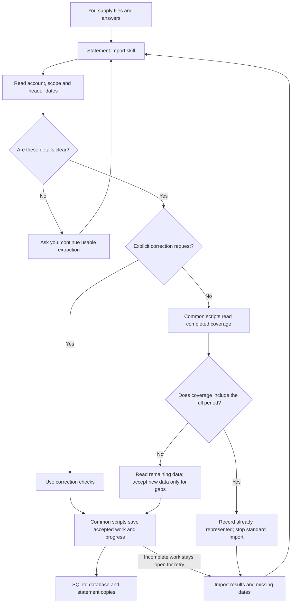

# BL-001 — How the statement import skill will work

Architecture revision 2. Date: 3 November 2026. **Status: approved under APR-ING-ARCH-002**, user message “approved.”, 3 November 2026. Approval covers architecture revision 2, ARCH-D01–D06 and the software, file and privacy rules. Detailed design and implementation need separate approval.

This plan uses approved requirements revision 4, approval APR-ING-REQ-004. It applies to BL-001, scope revision 8, in approved backlog revision 8. Assignment: ARCH-BANK-001 r2.

Revision 2 changes the import checks in decisions D03–D05. Decisions D01, D02 and D06, and the software, file and privacy checks remain unchanged.

## Purpose

The statement import skill will read your statements, check the information and save it for later use. It will keep one local SQLite database and copies of the original statements.

The skill will accept text PDFs, CSV files and XLSX files. It will use the existing document skills where suitable. It will report files that it cannot read correctly. It will not claim that it supports every bank statement format.

The skill will make usable information available even when some files or date ranges are missing.

This plan covers statement import only. Separate work will add Banker, transaction tagging, transfer analysis, spending reports and balance forecasts. This plan does not add scanned-statement reading, bank connections, vector search or a running database service.

## Main steps

1. You select the saved history and supply files.
2. The skill reads account details, statement scope and header dates without changing the files.
3. The skill asks about missing or unclear details. It continues to extract usable information, but keeps coverage unconfirmed.
4. For a standard import, the scripts compare the confirmed period with completed coverage for that account and statement scope.
5. If the full period is covered, the scripts stop the standard import. If only part is covered, they accept new data only for gaps.
6. The scripts check and save accepted information. They record progress and unresolved work.
7. The skill reports results, skipped ranges, known balances and missing or uncertain dates.

Explicit correction and replacement requests use the correction process instead of the standard range stop.

The diagram shows proposed steps, not completed software. All reads and changes to saved history use the common scripts. For each file, the coverage check includes completed imports from the same batch. The check and related changes must not use conflicting saved states.

## Decision ARCH-D01 — Read the file, then check its meaning

**Proposal:** use existing document-reading software to get text, tables and source locations. Let the agent identify account details and statement fields. Then use Python scripts to check the proposed information before saving accepted records.

Keep the page, row or worksheet reference for each item. Keep missing values unknown. Report unsupported layouts and uncertain results. Reading a row successfully does not prove that the agent understood it correctly.

The agent may identify a debit or credit convention. It may identify a statement period in the header. It must still follow the approved checks for amounts, currency, accounts, sources and date coverage.

**Other option:** write a separate reader for each known bank layout. This can give more predictable results for those layouts. However, each layout needs separate maintenance. We may add such readers later.

**Do not use:** let the agent save its interpretation without checks. This would make errors and repeated imports harder to control.

Requirements: ING-001, ING-003, ING-004, ING-007, ING-013 and ING-014.

## Decision ARCH-D02 — Use common scripts for saved history

**Proposal:** include common Python scripts with the statement import skill. These scripts will apply the same save, correction and recovery rules for all later skills.

Later skills must check that they can find and use the required version of these scripts. If they cannot, they must explain the problem. They must not create a separate copy of the storage rules.

Reports may read saved information through an agreed read method. They do not need to perform statement imports to read it.

**Other option:** let each skill read and change the database separately. This needs less shared setup at first. However, each skill could apply different rules and damage another skill's records.

A separate running service is another option, but it does not fit the approved local setup.

Detailed design will define the database tables, script commands, version checks and safe database changes. This plan does not change the installer scripts.

Requirements: ING-002, ING-005, ING-010, ING-011, ING-012 and ING-014.

## Decision ARCH-D03 — Record progress so interrupted imports can continue

**Proposal:** keep the original statement copy before reporting its related records as fully saved. Record which work succeeded, which work needs an answer and which work stopped before completion.

Saving a statement file and updating SQLite are separate operations. A successful database save does not prove that the statement copy also succeeded. [SQLite explains its database save guarantees](https://www.sqlite.org/atomiccommit.html).

After an interruption, check the saved progress and statement copies before continuing. A copied file alone does not prove that the import succeeded. A missing statement copy prevents the skill from claiming a complete save.

A failed file must not cancel successful files in the same upload. A retry must not add records that the previous attempt already saved.

Keep incomplete work separate from completed coverage. Failed, partial or uncertain imports must not stop a later import as fully covered. A retry uses saved progress to avoid adding accepted records again.

After one file completes, use its verified coverage when checking the next file in the same batch. Recheck coverage before accepting changes if another import could have changed it. Keep the coverage check and the acceptance decision under the same control for changes to saved history.

Allow only one change to the local history at a time, or return a clear busy message. Do not let two agents make conflicting record decisions at the same time.

When the skill cannot open a database, it must explain the problem. It must not replace or reset the database without permission.

Exports and recovery copies must keep the database and the related source information together. Before a large replacement or deletion, offer a recovery copy. Explain its contents, location and retention. Respect a decision not to keep that copy. Do not delete the user's originals outside the managed history.

**Other option:** treat the full upload as one save and assume the files and database always succeed together. Do not use this option. It can hide partial failures and discard successful work.

Detailed design will define the exact save steps, recovery checks and file cleanup rules.

Requirements: ING-002, ING-009, ING-010-I, ING-010-K and ING-012.

## Decision ARCH-D04 — Check the period before adding transactions

**Proposal:** first check the account, statement scope and header period against completed, verified coverage. Use dates supplied by the user when the header does not provide clear dates.

For a standard import:

- If one or more saved ranges cover the full incoming period, stop. Record “already represented,” its reason and the prior coverage used.
- Do not add transactions, balances or extra coverage from that skipped import.
- Apply this rule even when file contents have changed.
- Do not claim that the skipped rows were checked individually.
- If coverage contains gaps, accept new data only for those gaps.
- Check records in the overlap when needed to prevent repeated entries or identify conflicts. Do not add new transactions from the covered part through a standard import.
- Keep records unresolved when their dates do not safely place them in a covered or uncovered part. Ask for the needed answer.

Use coverage only when it includes the incoming account and statement scope. Another account's coverage must not stop the import. A statement for one card does not establish coverage for the full account.

For example, if January is complete and a yearly statement arrives, accept supported new data only for the uncovered months. If the full year is already complete and January arrives, stop the standard import.

Use a file-content check to recognise exact repeats. Do not use filenames as proof. Failed, partial and interrupted imports remain open for retry.

Where import work remains, keep source entries separate from the transactions that the history counts:

- Match within the correct account.
- Use a reliable bank transaction reference when available.
- Otherwise compare dates, exact signed amount, currency, description and supported card details.
- Keep transaction dates and posting dates distinct.
- Match separate purchases one at a time.
- Keep genuine purchases with identical values separate.
- Keep uncertain matches for review without adding them as verified activity or removing existing verified activity.

These fields help compare records. They do not prove that two records describe the same transaction. Do not use filenames or row numbers to match transactions across files. Do not treat refunds as repeated purchases merely because descriptions match.

An explicit correction, replacement or missing-transaction check uses ING-011 instead of the standard range stop. Preserve source evidence and previous values. Ask when the requested change is unclear. Do not automatically apply changed amounts or changes from pending to completed transactions in a covered period.

**Other option:** read and compare every transaction in each uploaded statement, including fully covered periods. The earlier proposal used this method. It could identify differences in a later file, but it requires more work and does not follow the approved range-first rule. Revision 2 uses the range check for standard imports and the correction process for requested checks or changes.

Do not remove records solely because their date, amount and description match. That method can remove valid purchases.

Requirements: ING-003, ING-005, ING-007, ING-009, ING-010-A–N and ING-011.

## Decision ARCH-D05 — Use header dates or user answers for coverage

**Proposal:** take statement start and end dates only from explicit statement-period information in the header, or from an explicit user answer.

Ask the user when a date is missing, unclear or contradictory. Continue to extract usable transactions while coverage remains unconfirmed.

Check these two questions separately:

1. Which dates does the statement claim to cover?
2. Did the import read all required information for the full account?

A header period alone does not prove a complete import. A list for one card does not prove complete coverage for the shared account.

A complete statement with no transactions can still confirm its full header period. Keep separate covered ranges when gaps exist. Find gaps only within the requested review period and the account's known active dates.

Keep unknown periods, confirmed missing ranges and user-declared unavailable or inactive periods distinct.

Use confirmed periods to check completed coverage before a standard import. Check the same account and statement scope. Include completed imports from the same batch.

Do not treat failed, partial or uncertain imports as complete coverage. Several completed ranges may cover the incoming period together. If a gap remains, the full period is not already represented.

Do not use transaction dates, inactivity, filenames, file dates, footer or body text, neighbouring statements or expected frequency to supply missing header boundaries.

**Other option:** use the first and last transaction dates, or the usual statement frequency. Do not use this option. Inactivity and changing statement frequency do not prove missing data.

Requirements: ING-005, ING-007, ING-008 and ING-011.

## Decision ARCH-D06 — Keep amounts, balances and account details clear

**Proposal:** keep exact amounts, currencies, dated balances, account and card links, and user settings as separate information.

A balance must include its date, type and source. Do not present an old statement balance as current available money. Do not count one shared credit-card account's debt again for each linked card.

Use exact number handling suitable for each currency. Detailed design will choose between suitable whole units, such as cents, and exact decimal amounts. Calculations must use an explicit precision and avoid number conversions that introduce rounding errors. [Python explains exact decimal calculations](https://docs.python.org/3/library/decimal.html).

When enough information exists, check whether the opening balance, movements and closing balance agree. Report a match, a difference or insufficient information. Do not invent an adjustment transaction to make the amounts agree.

Keep previous values and source details when a user corrects a record. Mark earlier calculated results that may need an update. This skill will not regenerate other skills' reports.

**Other option:** keep one simple account record with a balance but no date or history. This makes display easier, but loses the difference between past and current balances. It can also repeat shared-card debt.

Requirements: ING-003, ING-004, ING-005, ING-006 and ING-011.

## Required software and file checks

Prefer Python's built-in tools for SQLite, file-content checks, CSV, dates and exact number handling. Do not add larger tools unless the design shows a clear need.

| Task | Proposed software | Other option |
|---|---|---|
| Read PDF text and tables with source locations | Existing PDF skill guidance and pdfplumber | pypdf for suitable text layouts |
| Read XLSX without changing it | Existing spreadsheet guidance and openpyxl | pandas, with extra controls for amounts, dates and source locations |
| Protect XLSX reading from harmful file content | defusedxml or a checked equivalent | A separate safe reader, which would need more maintenance |

These names identify proposed Python add-ons. This plan does not install them or select their versions. Do not copy proprietary document-skill material into the new skill.

Check required software before reading a file. Some Python installations lack SQLite support. If required software is missing, explain what the affected file needs. Keep other supported formats and existing history usable. [Python documents SQLite support](https://docs.python.org/3/library/sqlite3.html).

Do not read an untrusted XLSX file without the required file protections. Do not fall back to an unsafe reading method. [Openpyxl explains these protections](https://openpyxl.readthedocs.io/en/stable/).

Do not change supplied spreadsheets or recalculate them. Do not invent values when a saved formula result is missing or uncertain. Do not execute macros, commands or instructions inside files. Do not follow embedded links. Reject unsupported macro-enabled file types.

Set limits for file size, page and row counts, expanded file content, memory use and processing time. A small file can still need much memory to read. Detailed design will set the limits and control method. [Pypdf describes PDF memory risks](https://pypdf.readthedocs.io/en/stable/user/extract-text.html).

Check selected file paths and managed filenames. Use only the selected history and supplied files. Keep unnecessary account identifiers out of routine messages and logs.

This skill will not send statement data to external vendor-search services. Local files do not prove that the host AI runs locally. Do not make that claim.

Repository Python work must use Python 3.13 or later, as the current project configuration requires. The older repository instruction says 3.12 or later. The current project configuration takes precedence for this work. The project currently lists only feedparser as an installed requirement, so the design must not assume that document-reading add-ons exist.

## Requirement checks

| Requirements | Decisions that address them |
|---|---|
| ING-001, ING-003, ING-014 | D01 and software checks |
| ING-002, ING-009, ING-012 | D02 and D03 |
| ING-004, ING-005, ING-006 | D06 |
| ING-007, ING-008 | D04 and D05 |
| ING-010-A–D, J | D04: full stop and gap-only import |
| ING-010-E–H | D04: record checks and corrections |
| ING-010-I, K | D03 and D04: retries and completed same-batch coverage |
| ING-010-L–N | D04 and D05: gaps, account scope and unclear headers |
| ING-011 | D04, D05 and D06 |
| ING-013 | File, access and privacy checks |

## Status and next approval

No essential user choice remains open for this proposal. We have not tested file reading, repeated-record matching, recovery or security behaviour. We have not confirmed support for every statement layout.

The earlier review used public technical documents. It did not process private statements or run scripts. Documentation references do not select software versions.

**Approval request:** approve architecture revision 2, decisions ARCH-D01–D06, and the unchanged software, file and privacy rules.

This approval permits detailed design of the tables and script commands. It does not permit implementation or remove the later approval steps.

## Change record

- 26 October 2026: the Architect proposed revision 1 from approved requirements revision 3. The proposal included the file-protection and common-storage clarifications.
- 3 November 2026: the Coordinator rewrote the text in simple language at the user's request. The decisions, alternatives, requirement references and pending approval remain unchanged. The [original wording](bank-ingestion-architecture-revision-1-original-wording.md) remains available. No code changed.

- 3 November 2026: revision 2 follows approved requirements revision 4, APR-ING-REQ-004. It checks completed date coverage before standard import, stops fully covered imports, accepts new data only for gaps, and preserves retries and explicit corrections. The [previous proposal](bank-ingestion-architecture-revision-1-before-range-change.md) remains available. No code changed.

- 3 November 2026: APR-ING-ARCH-002 records the user's approval of architecture revision 2. No design text changed. Next, prepare the detailed design.
