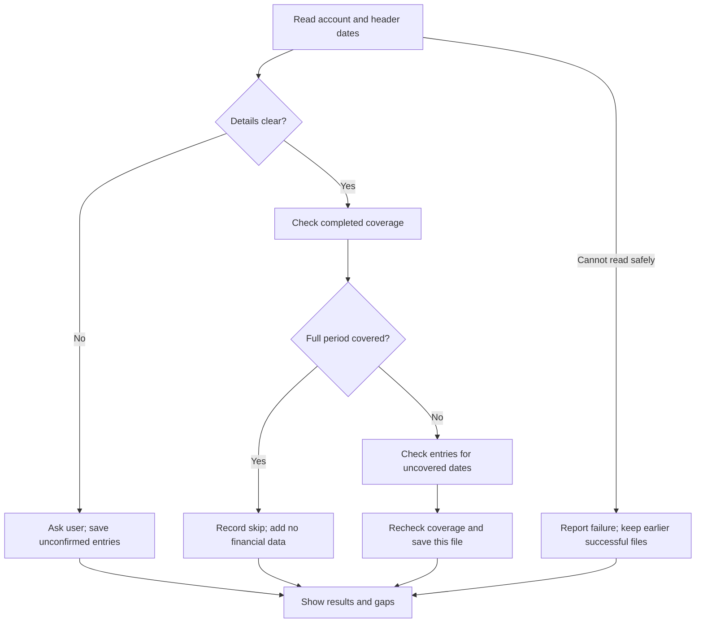
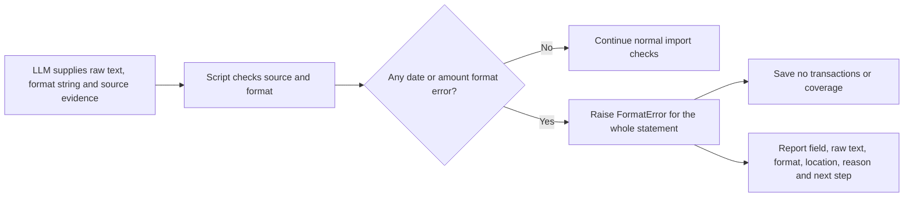

# BL-001 — Statement import design

Revision 4. 4 November 2026. **Approved baseline; BL-001 implementation complete under design revision 4.** Design revision 3 remains approved under APR-ING-DES-003. This revision changes library declarations and setup. It keeps the approved data model, functions and import rules. Step 3 passed independent tests, code review and security review. Revision 5 below is approved under APR-ING-DES-006; its implementation remains pending a separate approval.

Approved inputs: requirements 4 (APR-ING-REQ-004), architecture 2 (APR-ING-ARCH-002) and design 3 (APR-ING-DES-003), with this library setup update expressly requested by the user. Steps 1–3 are complete. The combined source passed independent testing and code/security review. See the iteration record for evidence and limits.

## 1. Reduce the first version

| Part | Design 1 | Current design |
|---|---:|---:|
| Database tables | 18 | 9 |
| Agent access | 22 commands | Direct Python functions |
| Python files | 7 | 2 |
| Saved import plans and request tracking | Required | Removed |
| Save method | Small row groups | One checked save per file attempt |

- Remove saved previews, request IDs, history revision counters, page tokens, separate issue records and separate reader-run records.
- Keep one database format number. Reject an unsupported format. The approved BL-009 update changes format 1 to format 2 only after clear user approval and in one SQLite transaction.
- Keep all approved requirements. Tagging, analysis, forecasts and Banker remain separate backlog items.

## 2. Saved data

Use one local SQLite database and retained statement copies.

| Table | Contents |
|---|---|
| `accounts` | ID, alias, bank, type, identity evidence, currency/precision, expected flag, active dates, target and safety buffer |
| `cards` | ID, parent account, alias, masked suffix, active dates and identity evidence |
| `files` | ID, content hash, size, format, original name, managed path and copy state |
| `statements` | File section, account/card scope, header dates/evidence, date basis, reader details, outcome and unresolved questions |
| `statement_records` | Original transaction or balance values, source locations, dates, description, reference, uncertainty, optional transaction link and superseded state |
| `transactions` | Stable ID, account/card, accepted transaction date, posting date, signed amount, currency, description, bank reference, pending/posted state, supporting record and active state |
| `tagging_rules` | Current user-approved vendor/category rules, with account/currency scope and user evidence |
| `periods` | Account/scope, inclusive dates, verified coverage or user period note, supporting statement/evidence |
| `changes` | Import attempts, answers and corrections: affected IDs, reason, old/new values and time |

- Use named columns for financial values. Use JSON only for source locations and change evidence.
- Several statement records can support one transaction. One statement record supports at most one transaction.
- Reports read accepted fields directly from `transactions`. Source values remain unchanged. Corrections save accepted fields and their evidence together; `changes` retains previous values and reasons.
- Balance entries have a date and type. They do not create transactions.
- Period notes record unavailable data, no activity or inactive accounts. They do not establish verified coverage.
- Format 2 adds current vendor/category, user tags, source details, uncertainty, state and optional rule ID to `transactions`. It does not keep earlier tag values or add tag-change history.
- Use generated IDs, `YYYY-MM-DD` dates, UTC change times and null for unknown values. Check record links.

## 3. Python functions and files

The user uploads files and answers questions in chat. The agent calls installed Python functions. No user commands or command router are required.

| File | Responsibility |
|---|---|
| `scripts/statement_reader.py` | Bounded text PDF, CSV and XLSX reading |
| `scripts/bank_history.py` | Checks, database saving, history reads and maintenance |
| `SKILL.md` | Agent steps, questions and use of installed document skills |

### Library declarations and setup

Each script declares its Python version and libraries in a PEP 723 comment section. Keep normal Python imports.

| Script | Declaration |
|---|---|
| `bank_history.py` | Python 3.13 or later; empty dependency list; built-in libraries only |
| `statement_reader.py` | Python 3.13 or later; defusedxml==0.7.1 for protected XLSX reads; installed pdfinfo/pdftotext for text PDFs |

- Do not distribute `requirements.txt`, a separate library list or a lock file.
- The documented setup requires `uv`. Report when it is missing; do not install it silently.
- Prepare the reader environment with `uv` only after the user authorises setup. Explain that setup can download libraries. Then use the prepared environment's Python to call the existing functions.
- Reading statements or importing Python modules must not install software or access the network. Report missing libraries. Keep history functions available without reader libraries.
- Skill instructions must give a checked setup method and identify the prepared Python interpreter. Add no command router or automatic setup.

Step 2 implementation uses POSIX process controls for reader limits. If required controls or PDF tools are missing, report unsupported without an unsafe read. CSV/history remain usable without XLSX protection libraries where their own required controls are available. Standard XLSX date styles and exact scientific numeric text retain raw values alongside checked values; unknown layouts/styles remain unresolved. These are implementation choices within the approved limits, not a claim that every bank layout works.

### Import and report functions

| Function | Input | Result |
|---|---|---|
| `read_statement` | File; headers or records; selected sections when known | Text/tables, source locations, reader details and limitations |
| `check_statement` | Selected history, source evidence, proposed account/scope/fields and user answers | Covered/uncovered periods, eligible records, unresolved records and questions |
| `save_statement` | Same source evidence, proposed fields and answers | Saved per-file outcome, added/matched/unresolved counts and coverage |
| `read_history` | Selected history, record kinds, account/date filters and review period for gaps | Accepted transactions, separate unresolved records, dated balances, account inventory, coverage, gaps and sources |

- Read headers first. Read transaction rows only when needed. The agent interprets fields; scripts check source quotations, locations, dates, signs and amounts.
- `check_statement` changes no saved history and creates no saved plan.
- `save_statement` repeats the checks against current history. It does not trust an earlier check result. It saves eligible and unresolved records together, with no counted transactions for an unresolved period.
- Outcomes: `imported`, `already_represented`, `partially_imported`, `failed` or `unsupported`. Return structured results and a plain explanation. Reject unknown input fields.

### Other required functions

| Function | Input → result |
|---|---|
| `create_history` | Explicit new folder → database/source folder; never overwrite history |
| `save_account` | Account ID or explicit new choice, fields/settings, evidence → saved account |
| `save_card` | Card ID or explicit new choice, parent account, evidence → saved card |
| `save_period_note` | Account, dates, note and user evidence → saved or withdrawn note |
| `correct_history` | Named records or replacement range, changes and user instruction/evidence → checked changes with earlier values retained |
| `export_history` | Selected history and destination → database/source recovery copy |
| `restore_history` | Recovery copy and new destination → checked restored history |
| `delete_history` | Selected scope, explained effects and recovery choice → removed data and disclosure of retained copies |

There are 13 functions, including `update_history_format`: selected history and explicit `user_approved=True` → update format 1 to 2 in one write transaction. The function adds the new fields and table, checks the schema, integrity and record links, then commits. On failure, it rolls back and checks that format 1 remains unchanged. It makes no separate copy.

Later skills find the helper through installed skill information. Keep one helper-version constant and one database format number; reject incompatible versions. Format 1 stays unchanged unless the user approves its update. Missing software produces an explanation, not installation. Do not change installers or copy licensed document-skill code.

## 4. Import rules

Record direct user answers with the statement or change. No separate question ID is required. After an answer, check and save the affected records again.

| Situation | Rule |
|---|---|
| Statement period | Use explicit header dates or user answers only; never use transaction dates, inactivity, filenames, frequency, footer or body dates |
| Full period covered | Stop standard import, even if contents differ; add no transactions, balances or coverage; report prior coverage used, not individual row checks |
| Partial overlap | Accept new data only for gaps; compare overlap where needed; keep conflicts unresolved |
| Boundary unclear | Ask which posting/transaction date basis applies; do not assign uncertain entries to a gap |
| Several sections/files | Check each account and scope; include completed earlier files in the same batch |
| Card-only coverage | Do not treat it as full-account coverage |
| Unknown period | Show readable entries separately; exclude them from counted activity |
| Record matches | Use account-specific bank references where reliable; otherwise compare supported fields; preserve genuine identical purchases and ask about uncertain matches |
| Explicit correction | Use `correct_history`; do not silently change covered records, pending payments or refunds |

## 5. Saving and retry

- Retain and check source bytes before saving related financial records. Record pending/ready copy state. Filenames do not prove identity.
- Read outside the database write. Then obtain exclusive control of changes, recheck coverage and save this file's accepted entries, unresolved entries, links and verified periods together.
- Each file succeeds separately. Save valid partial work, but do not complete uncertain coverage or let it stop a retry.
- Retry uses saved source entries. Changed reader output must agree with saved evidence; shifted row numbers do not prove identity. Stop and ask when agreement is unclear.
- After interruption, check saved records and copies. Remove incomplete managed work, reuse valid copies and retry unfinished work. Never reset damaged history.

## 6. Money and file protection

- Store signed whole minor units with confirmed currency precision. Keep one precision per currency. Reject rounding, unsupported precision and integer overflow. Return money as strings.
- Keep original decimal text, including XLSX numeric cell text. Do not claim exact values from approximate conversions. Keep currencies separate.
- Show dated balance types and reconciliation differences. Do not invent adjustments.
- Do not run formulas, macros or document instructions. Do not send statement data to web services.
- Use protected XLSX reading, controlled paths and bounded reader processes. Reject unsupported inputs or missing required protections.

| Limit | Maximum |
|---|---:|
| Files per batch / total size | 100 / 500 MiB |
| File size | 50 MiB |
| PDF pages / data rows | 1,000 / 250,000 |
| Expanded XLSX / archive entries / entry size | 250 MiB / 10,000 / 25 MiB |
| CSV field / extracted text / command input | 1 MiB / 64 MiB / 16 MiB |
| Reader time / memory | 120 seconds / 1 GiB |

## 7. Corrections and maintenance

- Explain affected records, files and shared-source effects before destructive changes. Offer a recovery copy for bulk replacement or deletion. Record the user's scope and copy choice; no saved preview IDs.
- Recheck affected values before saving. Stop if their change alters the approved effects.
- Keep earlier correction evidence and stable transaction IDs. Recalculate coverage and mark affected reports out of date.
- Export with SQLite's backup method and linked source copies. Restore only to a new selected folder; check copies and database before use.
- Deletion includes selected old values, observations, answers, corrections, work copies and sensitive logs. Include selected managed backups when requested. Disclose retained shared sources/backups; do not claim full deletion while copies remain. Keep external originals.

## 8. Four import examples

These are proposed results, not test results.

| Input or event | Steps and result |
|---|---|
| Completed monthly statement uploaded again | Read or reuse confirmed header/account evidence; check coverage; record `already_represented`; add no transactions, balances or coverage |
| January saved, then yearly statement uploaded | Check yearly header dates for the same account/scope; skip January for new financial data; check uncovered months; save supported records and report conflicts |
| Header dates missing | Save readable `statement_records` without counted transactions or verified coverage; ask the user; save the answer, recheck coverage and accept eligible records without repeating saved observations |
| Save interrupted | Check source copies and saved outcome. Before this attempt commits, none of its database changes apply; retry. After commit, reuse its records. Earlier partial work remains retryable without repeated transactions |

If changed reader output cannot match saved source evidence safely, stop and request review. Row numbers alone do not prove identity.

## 9. Coverage and approval

| Requirements | Design sections |
|---|---|
| ING-001–006: formats, history, sources, money, accounts/cards, balances | 2–6 |
| ING-007–010, cases A–N: dates, gaps, batches, repeats and retries | 4–5, 8 |
| ING-011–014: corrections, maintenance, privacy and distribution | 3, 6–7 |

**Approval record:** APR-ING-DES-003 approves design 3's data and behaviour. The user expressly requested revision 4's library declarations and setup update. Requirements 4 and architecture 2 remain unchanged. APR-ING-IT1-001 subsequently approved step 1 only; see the iteration record for current verification results.

Change record: designs 1 and 2 were not approved. Revision 2 reduced the tables and files. Revision 3 names original records `statement_records`, puts accepted reporting values in `transactions`, replaces broad command groups with function inputs/results and adds four import examples. No code, runtime tests or new research.

Revision 4 replaces the separate library list with inline declarations, keeps Python imports and requires explicit setup. Sources: [Agent Skills script guidance](https://agentskills.io/skill-creation/using-scripts), [uv script guide](https://docs.astral.sh/uv/guides/scripts/) and [uv command reference](https://docs.astral.sh/uv/reference/cli/). These sources describe supported methods; no setup or software tests ran during this update.

## Revision 5 — format inputs and errors (approved APR-ING-DES-006)

This revision changes only date/amount format input and format-failure handling. It does not change the database, reader, source checks, sign checks, exact-money rules or accepted history. It does not approve implementation.

### Inputs

The LLM passes string format variables for each date and amount field in the existing `Record`, then passes that record to `check_statement` and `save_statement`.

| Field | String passed by the LLM | Example |
|---|---|---|
| Date | A strict Python `strptime` pattern. Use a four-digit year and state the order. | `date_format = '%d/%m/%Y'` |
| Excel date cell | The explicit serial basis. | `date_format = 'excel_serial_1900'` or `'excel_serial_1904'` |
| Amount | Separate string variables for the decimal mark, group mark and group sizes. | `decimal_separator = ','`; `group_separator = '.'`; `group_sizes = '3'` |
| Amount with Indian grouping | The rightmost group size comes first; the final size repeats. | `decimal_separator = '.'`; `group_separator = ','`; `group_sizes = '3-2'` |
| Amount without grouping | Pass an empty group mark and empty group sizes. | `decimal_separator = '.'`; `group_separator = ''`; `group_sizes = ''` |

The `Record` docstring will list accepted date directives and separator values, with examples. The code will call `datetime.strptime(raw_date, date_format)` and use `strftime('%Y-%m-%d')` for the saved date. It will check a strict round trip. The amount code will validate the supplied separator and group-size strings, then use them to make exact decimal text for `Decimal`. The code will not choose a format from the raw value. Ambiguous date order or separator meaning still needs source evidence or a user answer. The LLM continues to pass original text, source location and sign evidence.

### Check and error flow

`FormatError` will contain a list of field errors. Each error will name the field, original text, supplied format string, source location, short reason and the next action. Its plain message will tell the LLM to check the format or ask the user. The script will raise this error before it writes statement rows. `save_statement` may keep its existing `import_failed` audit record; it must not save any accepted or unresolved financial rows from that statement. A corrected format starts a new check and save attempt. Other clear rows cannot save when any date or amount conversion fails, as requested. Other import issues keep their current partial-import behavior.

### Code and data changes

| Area | Proposed change |
|---|---|
| `Record` | Keep per-date `date_formats` as strings. Replace `amount_format` with decimal separator, group separator and group-size strings. Document the accepted values in the `Record` docstring. |
| Conversion | Remove the fixed date/amount format maps. Use the supplied date string with `strptime` and `strftime`; use the supplied amount variables with checked text conversion and `Decimal`. Keep no-rounding checks and explicit Excel serial handling. Do not evaluate or execute strings. |
| Source checks | Keep file hash, row/cell, date-column, sign and ambiguous-date evidence checks. Run them before saving. |
| Saved history | Keep the current schema and accepted values. Keep supplied format strings with the existing source evidence. No migration is needed for accepted transactions. On retry, the LLM reads the source and supplies a format string again. |
| Skill docstring | Tell the LLM which string forms to pass, how to use evidence and what to do with `FormatError`. |
| Tests | Cover custom date patterns, decimal/group separators, nonstandard group widths, unsupported format strings, failed conversions, no writes after a format error, and retry after correction. |

This revision updates completed BL-001 design revision 4. It supersedes the fixed-format-key and format-error partial-save rules. User approval covers the design only; implementation needs its own next-stage approval.

**Approval record:** APR-ING-DES-006. The user replied “approved” to revision 5 after choosing string variables, `strptime`/`strftime` date handling, documented accepted values and whole-statement stop on format failure. No code was changed by this approval.

## Revision 6 — evidence for unclear formats (approved APR-ING-DES-007)

This revision addresses two issues found during independent review. The user replied “approved both” on 5 November 2026, approving amount-format evidence and the workbook epoch check. APR-ING-DES-007 records this design approval. It does not approve implementation; the revised implementation plan needs separate approval.

| Case | Proposed check | Result when the check fails |
|---|---|---|
| Amount separator has more than one valid meaning | Add `amount_format_evidence: Evidence | None` to `Record`. Require matching source evidence or a user answer that names decimal mark, group mark and group sizes. | Raise `FormatError` for the whole statement. Include original amount, format values, source location, reason and next action. Save no financial rows or coverage. |
| Excel amount date uses a serial | Have the protected reader report workbook epoch (`1900` or `1904`). Require the supplied serial key to match. For recognized date styles, also require a matching `canonical_date`. | Raise `FormatError` for the whole statement if the epoch or canonical date is missing or conflicts. Save no financial rows or coverage. |

The reader change adds one metadata value to its existing result. It does not change file access or workbook reading rules. The history helper checks that value against the LLM-supplied date key. Both Excel bases remain supported. Other date formats remain unchanged.

Tests will check clear amount formats without evidence; unclear formats with missing, matching and conflicting user evidence; valid and invalid source evidence; both matching Excel epochs; wrong epoch with no saved data; missing canonical date for a styled cell; a nonnumeric serial; and unchanged text-date handling.

The amount evidence rule makes revision 5's existing evidence requirement implementable. The workbook epoch metadata changes the approved step's file list. The revised implementation plan and its full file list need separate approval before this work starts. No downstream approval is implied here.
