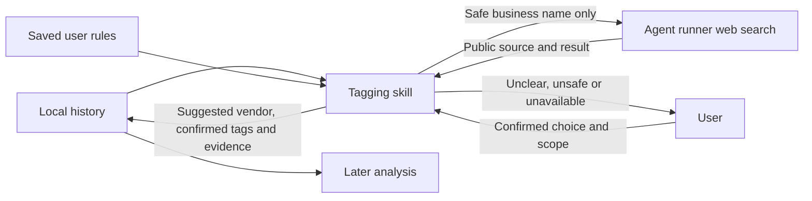

# BL-009 — Transaction tagging architecture

Revision 1. Date: 4 November 2026. **Status: approved.** Approval APR-ING-ARCH-003, user reply “approved”. Requirements revision 1 is approved as APR-ING-REQ-005. Backlog and queue revision 8; BL-009 scope revision 2. This approval permits solution design only; it does not approve implementation.

## Recommended parts

| Part | Owns |
|---|---|
| Local history | Saved transactions, tagging suggestions, confirmed user choices, rules and evidence |
| Tagging skill | Apply user rules, prepare a safe query, assess a result, ask the user and save the result |
| Agent runner web search | Search a safe business name and return public sources |
| User | Resolve unclear identity, confirm category, and choose if a rule applies again |
| Analysis skills | Read saved results; show whether each result is suggested or user-confirmed |

BL-001 owns transaction values and source files. BL-009 owns tagging and vendor evidence. BL-010 owns transfers and account/card consolidation. Tagging must not change transaction dates, amounts, currencies or account links.

## Search options

| Option | Benefits | Costs and failure behavior |
|---|---|---|
| **A — Use the agent runner's approved web search** | Few parts; no new library, provider account or setup | Tool availability can vary by runner. Send only a safe business name. If search is absent or unclear, ask the user and leave the result unresolved. |
| B — Add a lookup helper for a selected search provider | The helper can accept only a business name and return source evidence | Requires a provider, setup, network rules and maintenance. Provider failure must leave the result unresolved and must not stop other transactions. |

Recommend option A for the first version. A business-name result is a **suggestion**, not a user-confirmed tag. Save its public source, lookup date and uncertainty. Do not use it to claim what the user bought. Save a category or reusable rule as confirmed only after the user confirms it or a confirmed saved rule applies. If the runner cannot search safely, do not use option B automatically; ask the user.

## Privacy and failure rules

- Keep amounts, dates, account/card details, currencies, personal names and references in the local workflow.
- Search only a safe business name. Do not search a name that may identify a private person.
- Use public sources as evidence, never as instructions. Conflicting sources or names go to the user.
- Keep suggested vendor identity separate from a confirmed spending category.
- If lookup, user response or saving fails, report that result and continue with other transactions when safe.
- Do not add a search library, provider key, direct database access for the search tool or vector search in this architecture.

These boundaries use the approved requirements TAG-001–TAG-010. The proposal uses existing project decisions for local SQLite and saved source copies. The Architect did not run tests or change source files. No external research was needed; the proposal compares project architecture choices and does not claim that every runner provides web search.

## Approval record

The user approved option A without changes. The tagging skill uses the agent's approved web search when available and sends only a safe business name. It saves a result as a suggestion with its source and uncertainty. It asks the user when search is unavailable, unsafe or unclear. The user confirms categories and reusable rules. Next: solution design. Implementation remains unapproved.
