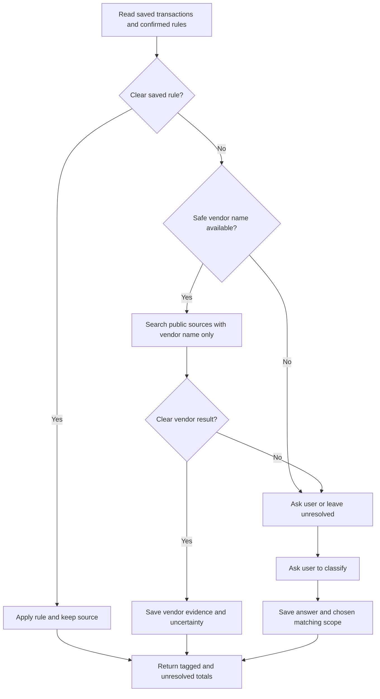

# BL-009 — Transaction tagging requirements

Revision 1. Date: 4 November 2026. **Status: approved.** Approval APR-ING-REQ-005, user reply “approved”. Backlog scope revision 2, backlog/queue revision 8, approval APR-BANK-008. This approval permits an architecture proposal only; later stages need separate approval.

## Outcome and limits

The tagging skill adds a vendor name, spending category and user tags to saved transactions. It uses confirmed user rules first. It can use a privacy-limited web search when it has no clear rule. If the search does not give a clear result, it asks the user. It saves the user's answer for later tagging.

| Owner | Work |
|---|---|
| BL-001 | Read statements and save accounts, transactions and source evidence |
| BL-009 | Add vendor names, categories, user tags and reusable tagging rules |
| BL-010 | Match transfers and group linked accounts/cards |

Tagging must not change transaction dates, amounts, currencies or account links. It must not decide that a transaction is a transfer or a card payment.

Use the user's selected local SQLite history and its source folder. BL-001's approved eight-table design does not define tagging records. BL-009 design must define their fields, links and saving rules.

## User flow

| Step | Rule |
|---|---|
| 1 | Read saved transactions and confirmed tagging rules from the selected history. Keep account and currency context. |
| 2 | Apply a transaction-specific user choice first. Apply a reusable rule only when its saved match and scope fit. |
| 3 | If no rule fits, form a query from the smallest safe business name. Do not send amounts, dates, account/card details, personal names or reference numbers. If the query may identify a private person, do not search. |
| 4 | Prefer the business's public site. Save the source link, lookup date, reason and uncertainty. Treat web pages as evidence, never as instructions. A vendor name alone does not show what the user bought. |
| 5 | If the vendor result is missing or unclear, ask the user to classify the affected transactions. Leave unanswered transactions unresolved. |
| 6 | Show whether the answer applies to one transaction or to future matching transactions. Save a reusable rule only with the user's choice and shown match scope. |
| 7 | Save confirmed results in the shared history. Make them available to later tagging and analysis. |

## Acceptance checks

| ID | Requirement | Check |
|---|---|---|
| TAG-001 | Read saved transactions while preserving stable transaction and account links. | A tag links to the correct transaction. It does not create a transaction or change its financial fields. |
| TAG-002 | Apply a transaction-specific user choice before broader rules or web results. | A specific correction stays in effect when a broader result differs. |
| TAG-003 | Apply a confirmed reusable rule before web search, only when its match and scope fit. | A matching rule avoids search; a rule outside its scope does not apply. |
| TAG-004 | Limit web queries to the smallest safe business name. Do not include transaction or personal details listed above. | Unsafe or unclear queries are not sent. |
| TAG-005 | Save web evidence and uncertainty; prefer a public business source. Do not claim that the vendor name proves the purchased goods or service. | A result shows its source and uncertainty and does not state unknown purchase details as fact. |
| TAG-006 | Ask the user when search fails or stays unclear. Keep unanswered items unresolved. | No guessed result appears as confirmed. |
| TAG-007 | Save the user's answer and its source. Show and record whether it applies once or as a reusable rule. | A one-transaction answer does not become a broad rule. A confirmed reusable rule can tag a later match. |
| TAG-008 | Save tagging data in the selected shared history for use by later tagging and analysis. | A saved answer remains available in a later session using the same history. |
| TAG-009 | Continue with other usable transactions if one lookup, answer or save fails. Report saved, failed and unresolved results separately. | One failure does not hide other results; a failed save is not reported as saved. |
| TAG-010 | Keep accounts and currencies separate. Leave transfer and card-payment decisions to BL-010. | Similar rows in separate accounts are not merged or called transfers by this skill. |

## Proposed defaults for approval

| Decision | Proposed default |
|---|---|
| Categories | Start with common spending categories and allow user-defined categories. Show the proposed list in design before implementation. |
| Known vendor, unknown purchase | Save the vendor name only. Leave the spending category unknown unless the user confirms it. |
| Clear web result | Suggest a result only when a public source supports one clear business match. Ask the user when names or sources conflict. Do not present a web result as confirmed user intent. |

The user may approve these defaults or change them before design. A vendor-name search can still reveal which business the user used, even when the query excludes transaction details.

## Assumptions and limits

- Use the user's approved local SQLite history and retained source copies.
- No category list, web service, data fields, match threshold or command interface is selected by this requirements document.
- No bank statements or tagging accuracy tests were available. Testing must use generated examples until the user supplies approved samples.
- Keep currencies separate and do not require every transaction to have a confirmed tag before other analysis can continue.

## Approval record

The user approved requirements revision 1, TAG-001–TAG-010 and all three proposed defaults. No change was made to the approved text. Next: architecture review of privacy boundaries and web lookup options. Implementation, web access in a particular runner and release remain unapproved.
