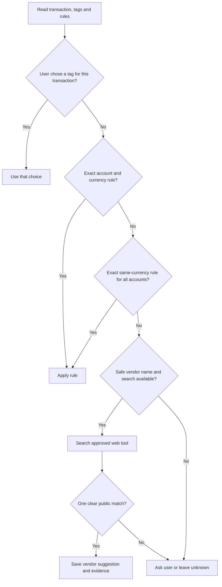

# BL-009 — Transaction tagging solution design

Revision 4. Date: 4 November 2026. **Status: approved. Approval APR-ING-DES-005, user reply “approved”. Revision 3 remains preserved as [the approved copy](bank-tagging-solution-revision-3-approved.md), approved as APR-ING-DES-004. Requirements revision 1 is approved as APR-ING-REQ-005. Architecture revision 1 is approved as APR-ING-ARCH-003. Backlog and queue revision 8; BL-009 scope revision 2.

## Recommended storage

Save a transaction's current vendor and category in that transaction's existing row. Do not save a separate history of tag changes. Add one table for reusable rules.

| Place | Saves |
|---|---|
| `transactions` | Current vendor, category, user tags, suggested/confirmed state, source, lookup date, uncertainty, and matching rule ID |
| `tagging_rules` | User-approved exact match, account/currency scope, vendor, category, user tags, user evidence and active state |

This avoids a separate tag row for every transaction and avoids a separate tag-change history. A reusable rule is separate because it applies to future transactions. It needs a clear match, scope, and its own removal behavior.

| Option | Benefit | Cost |
|---|---|---|
| **Recommended: transaction fields plus one rule table** | Current tags stay with their transactions; the skill can find and remove rules directly | Adds one table and changes the transaction table |
| Store rules in `changes` | Adds no table | The skill must search and decode audit text to find active rules; update and removal are harder |
| Store rules as fields on old transactions | Adds no table | Removing or changing an old transaction may change future tagging; a transaction is not a rule record |

## Rule match and order

The user can choose one of two scopes. Use an exact normalized vendor match in both scopes.

| Scope | Applies to |
|---|---|
| One account and one currency | The selected account only |
| All accounts in this history with one currency | Any account in this history with that currency, including accounts added later |

Apply a user choice for one transaction first. Then check its exact account-and-currency rule. Then check an exact same-currency rule for all accounts. If rules conflict, ask the user. Never apply a rule across currencies or merge accounts.

A web result can suggest a vendor. It cannot confirm a category or what the user bought. Ask whether the user's choice applies once or as a reusable rule. Show the rule's exact match and scope before saving it.

## Python functions and skill

Add three functions to the existing `bank_history.py`. The skill uses the approved web search; Python code sends no web requests.

| Function | Input → result |
|---|---|
| `read_tagging_data` | History and optional account, transaction or date filters → transactions, current tags and matching rules |
| `save_tagging_result` | History, transaction ID, proposed tag and evidence → saved result or clear failure |
| `save_tagging_rule` | History, exact match, selected scope, category/tags and user evidence → saved rule or clear failure |

Check transaction IDs, active state, account/currency scope and required evidence. Require a public source for a web suggestion. Require user evidence for confirmed tags and rules. Save each transaction's new tag fields as one database action. Do not add a tag-change record. Save a reusable rule as one database action. Report saved, failed and unresolved results separately. Continue with other transactions when safe.

The skill checks user choices, then exact rules, then safe web search. It asks the user when search is unsafe, absent or unclear. It saves the public source, date and uncertainty with a suggestion. It leaves unanswered items unresolved. Tagging must not change transaction dates, amounts, currencies, account links or card links.

## Existing history update

The approved BL-001 design has eight tables, database format 1, and rejects other formats. Adding tag fields and `tagging_rules` changes that design. The existing helper inserts transaction values by column position. Use a single SQLite transaction for the update.

| Update step | Rule |
|---|---|
| Start | Ask the user before updating the selected history. Then start one write transaction. |
| Change | Add the tag fields, create `tagging_rules`, and set format 2 within that transaction. Do not make a separate copy of the history. |
| Check | Before commit, check the expected table fields, format number, database integrity and links between records. |
| Commit | Commit only when all checks pass. |
| Failure | Explicitly roll back the transaction. Keep format 1 and its data unchanged. Report the error. |
| Deletion and recovery | Include the new fields and rules in deletion, export and restore checks. Show a same-currency all-account rule during account deletion; keep it only if the user agrees. |

Do not update an existing history before the user agrees. If any update or check fails, commit none of the changes. This changes the completed BL-001 storage design, history helper, deletion/export/restore behavior and tests. The user must approve this design revision before implementation. The update itself must also require user approval when it runs.

## Implementation checks

| Area | Check |
|---|---|
| Rules | User choice first; account rule before same-currency rule; exact match; conflict stays unresolved |
| Scope | One-account rule stays with that account; same-currency rule stays within the selected history and currency |
| Privacy | Search receives only a safe business name; no amounts, dates, accounts, cards or references |
| Evidence | Suggested vendor has a source and date; suggestion does not become a confirmed category |
| Saving | Current tag fields save; a failed save is reported; other transactions can continue |
| Safety | Financial fields stay unchanged; deletion, copy and restore include tag fields and rules |
| Existing histories | A declined or failed update leaves format 1 unchanged; a successful update commits all changes together as format 2 |

The Solution Designer mapped this design to TAG-001–TAG-010. It did not change code or run tests. No real account history was inspected. Revision 1 proposed two new tagging tables. Revision 2 moved current tags onto transactions and kept one rules table, but included tag-change history. Revision 3 removed that history and was approved as APR-ING-DES-004. The user then directed that the update use one database transaction without a separate copy. This revision replaces only the history-update method. Revision 4 is approved as APR-ING-DES-005.

## Approval record

The user approved solution design revision 4 as APR-ING-DES-005. This approval permits iteration planning only. It does not permit code changes or an update to saved data.

SQLite supports explicit commit and rollback. Its table-change commands include adding columns. The plan still requires tests against the SQLite version in use: [transaction guidance](https://www.sqlite.org/lang_transaction.html) and [table-change guidance](https://www.sqlite.org/lang_altertable.html).
